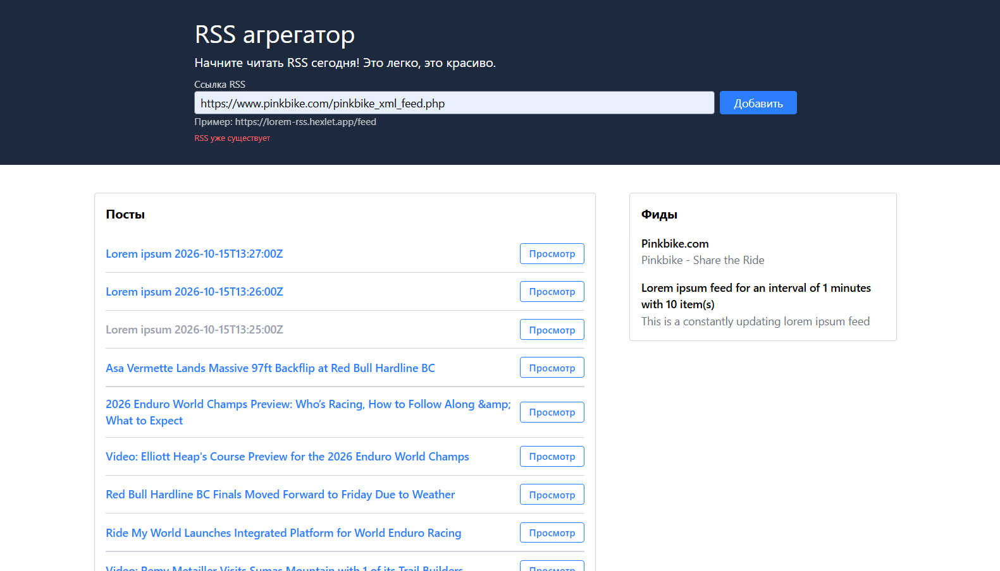

### Hexlet tests and linter status:

[](https://github.com/myxtaridse/frontend-project-11/actions) [](https://github.com/myxtaridse/frontend-project-11/actions/workflows/lint-check.yml)

# RSS агрегатор

**RSS** — это специализированный формат, предназначенный для описания лент новостей, анонсов статей и других материалов. Это наиболее простой способ для сайтов (обычно, блогов) дать возможность пользователям подписываться на изменения. Для этого используются специальные сервисы, называемые RSS-агрегаторами. Эти сервисы умеют опрашивать RSS-ленты сайтов на наличие новых постов и показывают их в удобном виде, отмечая прочитанное и так далее.

Данный сервис предназначен для агрегации RSS-потоков, с помощью которых удобно читать разнообразные источники, например, блоги. Он позволяет добавлять неограниченное количество RSS-лент, сам их обновляет и добавляет новые записи в общий поток.

## Требования

- Unix system (macOs/Linux)
- Nodejs 20.x+
- Make

## Стек

- JavaScript (ES6+)
- HTML5
- Tailwind CSS 4 + @tailwindcss/forms
- Architecture: MVC
- Build Tools: Vite
- Libraries: valtio/vanilla (реактивное состояние), yup (валидация), axios (http-запросы), i18next (организация текстов интерфейса)
- Linting/Formatting: Oxlint, Oxfmt
- CI/CD: GitHub Actions, Vercel

## Установка

```bash
git clone https://github.com/myxtaridse/frontend-project-11.git
cd frontend-project-11
make install
```

## Сборка

```bash
make build
```

## Запуск локального сервера

```bash
make run
```

## Демо

[https://frontend-project-11-pied-two.vercel.app](https://frontend-project-11-pied-two.vercel.app)


